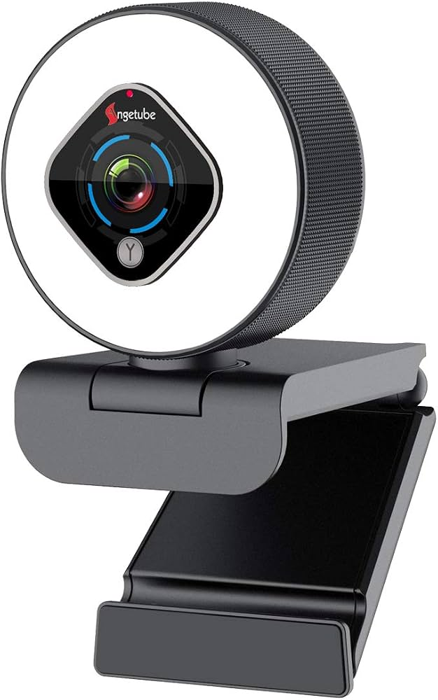

The firmware was dumped from the GigaDrive 25Q40CT Flash chip on the [angetube camera](https://www.amazon.co.uk/Microphone-Adjustable-Brightness-Angetube-962/dp/B08T9GHKJX)
firmwares header is SN9C285 while this specific camera model has a SONIX SN9C2279SJG chip.

